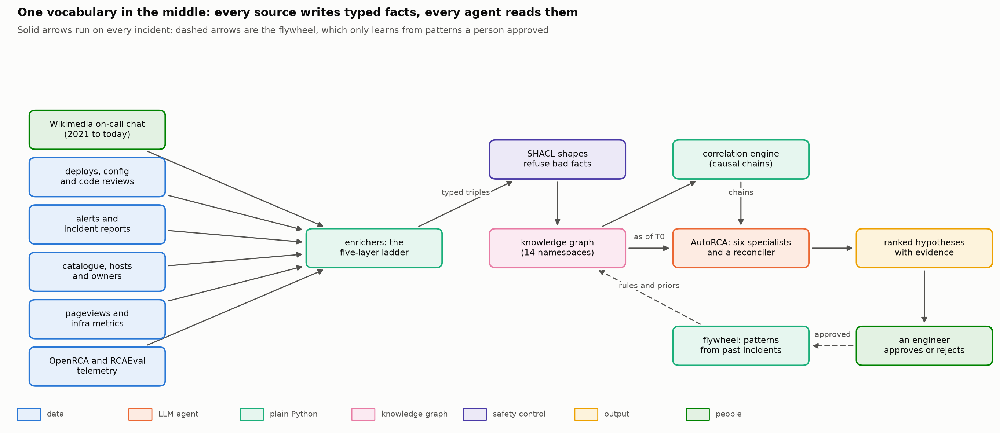
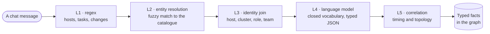
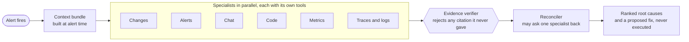
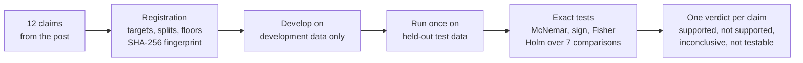
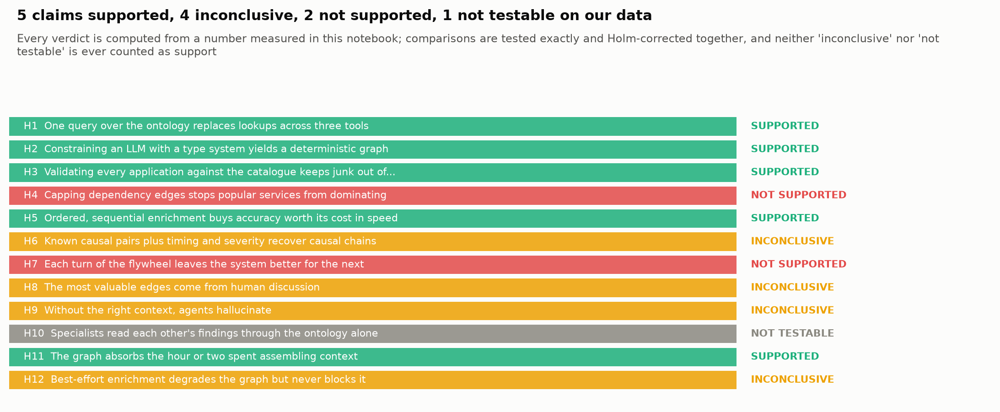
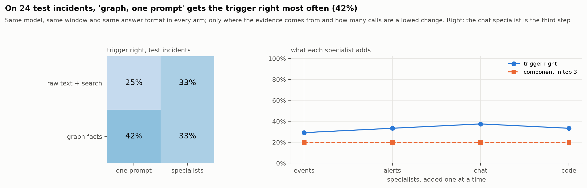
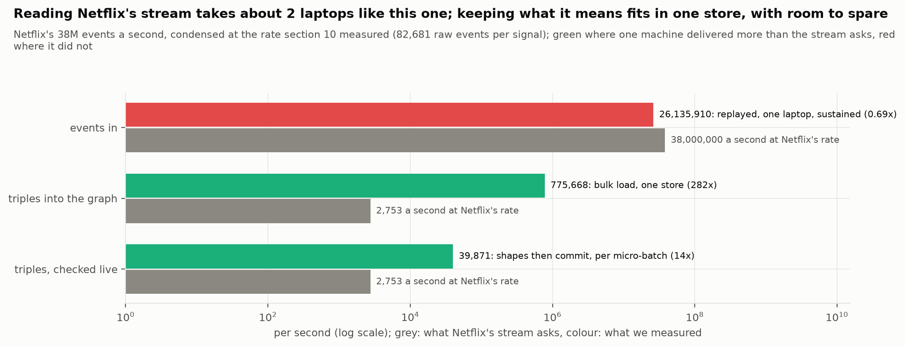
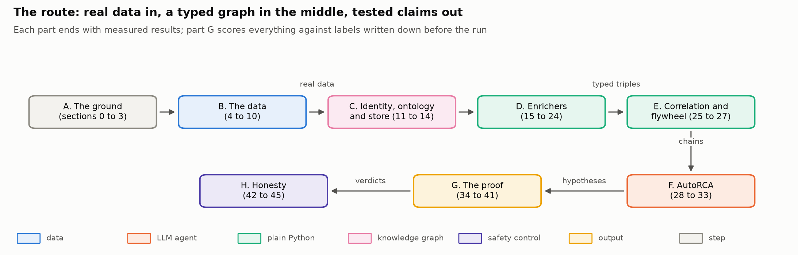

<div align="center">

# Ontology-Driven Observability, Rebuilt and Tested

**Netflix's knowledge-graph design for incident root-cause analysis, rebuilt from its public
description on 1.9 billion rows of real operations data, with every claim put to a test written
down before the results existed.**


[What it is](#what-it-is) ·
[Architecture](#architecture) ·
[Results](#results) ·
[Scale](#how-far-it-scales) ·
[Getting started](#getting-started) ·
[Repository layout](#repository-layout) ·
[Reproducibility](#reproducibility-and-integrity)

<br>



</div>

<br>

## At a glance

<div align="center">

| 1.9B | 48 | 90 | 12 | 51 | 0 |
|:---:|:---:|:---:|:---:|:---:|:---:|
| real rows analysed | notebook sections | figures, every one computed | claims tested | bugs found and logged | live model calls on a rerun |

</div>

## What it is

In October 2026 Netflix described how they diagnose incidents with an ontology: every alert,
deploy, metric, log line and chat message becomes a typed fact in one knowledge graph, language
models are held to a closed vocabulary, a correlation engine proposes causal chains, a flywheel
learns from past incidents, and a team of specialist agents investigates while the alert is
still firing. A design post persuades by explaining; it does not have to measure.

This repository rebuilds that system end to end from the description, runs it on public data
that behaves like the real thing, and measures each claim the post makes:

- **Wikimedia's operations record** (one of the ten largest websites): five years of on-call
  chat, every logged production change, alerts, code review and 414 written incident reports.
- **OpenRCA**: metrics, logs and traces from a bank, a telecom operator and two e-commerce
  clusters, with an answer key.
- **RCAEval**: 360 injected failures in three microservice applications.
- **Wikipedia pageviews**: every page of every wiki, every hour, for the week around the
  incident we follow, as the user-impact layer.

Everything lives in one long, course-style notebook: 48 sections in eight parts, from first
principles to a pre-registered exam, with every number printed by the cell that computed it.

## Architecture

```mermaid
flowchart LR
    subgraph SRC["Real data"]
        direction TB
        chat["On-call chat<br/>1.7M lines"]
        sal["Production changes<br/>539k entries"]
        alerts["Alerts<br/>1.49M firings"]
        reports["Incident reports<br/>414"]
        catalog["Service catalogue<br/>5,593 hosts"]
        pv["Pageviews<br/>1.14B rows"]
        tel["OpenRCA and RCAEval<br/>775M rows"]
    end

    ladder["Enrichers<br/>the five-layer ladder"]
    gate{{"SHACL shapes<br/>and the catalogue gate"}}
    kg[("Knowledge graph<br/>Oxigraph, 14 namespaces<br/>PROV-O provenance")]
    corr["Correlation engine<br/>causal chains"]
    rca["AutoRCA<br/>specialists and a reconciler"]
    out["Ranked hypotheses<br/>with evidence"]
    eng(["An engineer<br/>approves or rejects"])
    fly["Flywheel<br/>patterns from past incidents"]

    SRC --> ladder --> gate --> kg
    kg --> corr --> rca
    kg -- "as of T0" --> rca
    rca --> out --> eng
    eng -. "approved" .-> fly
    fly -. "rules and priors" .-> kg
```



The graph never stores raw events, only what an enricher concluded from them, and every fact
carries the run and enricher that wrote it. Agents see the record **as it stood fifteen minutes
after readers were first affected**, so nothing written later (the incident report, the fix) can
leak into a diagnosis; a planted canary fact proves it.

<details>
<summary><b>The five-layer ladder: cheap and certain first, a language model only where needed</b></summary>
<br>



Each layer resolves what it can and passes the rest up, so the model only sees what the
deterministic layers could not settle, and it can only answer with ids from a closed list.

</details>

<details>
<summary><b>AutoRCA: specialists with tools, an evidence check, a reconciler</b></summary>
<br>



Each specialist gets at most three rounds of tool use before it must answer. Its tools return
typed, identity-resolved evidence (changes by kind, alert episodes, owners, telemetry signals) or
keyword matches from chat, and it may cite only the ids those tools returned.

</details>

<details>
<summary><b>How every claim was tested</b></summary>
<br>



Development and test data are split by date (Wikimedia) and by cluster (OpenRCA). Every method
must beat two floors, a random answer and the commonest development answer, and is compared with
published results where they exist. Neither "inconclusive" nor "not testable" ever counts as
support.

</details>

## Results



**The plumbing holds; the intelligence claims need more evidence than public data can give.**

| | Claim from the post | Verdict | What decided it |
|---|---|:---:|---|
| H1 | One query over the ontology replaces lookups across three tools | **Supported** | the same changes and owners as five lookups, at 217 of 217 alert moments with an answer |
| H2 | A type system makes a language model's output deterministic | **Supported** | a closed vocabulary repeated itself on 9 of 10 conversations, free JSON on none (Holm p 0.03) |
| H3 | Validating applications against the catalogue keeps junk out | **Supported** | 3,734 junk service names refused |
| H4 | Capping dependency edges stops popular services dominating | Not supported | no change on the one hub large enough to try it |
| H5 | Ordered enrichment buys accuracy | **Supported** | 8 links in planned order, none out of order |
| H6 | Known causal pairs plus timing recover causal chains | Inconclusive | right direction, Holm p 0.11 against a placebo |
| H7 | Each turn of the flywheel improves the system | Not supported | learned rules better on 7 held-out tasks, worse on 8 |
| H8 | The most valuable edges come from human discussion | Inconclusive | adding chat changed one incident |
| H9 | Without the right context, agents hallucinate | Inconclusive | one incident differs |
| H10 | Specialists read each other's findings through the ontology | Not testable | our specialists report to a reconciler |
| H11 | The graph absorbs the hour or two spent assembling context | **Supported** | an answer in 14 s against a median 62 minutes for people to find a cause |
| H12 | Best-effort enrichment never blocks the graph | Inconclusive | one incident differs |

<table>
<tr>
<td width="50%"></td>
<td width="50%">

**The most useful finding.** On 24 labelled test incidents, the graph's facts in a **single
prompt** named the right trigger 42% of the time. A team of specialist agents reached 33%, at
seventeen times the cost. Raw text found by keyword search managed 25%, and was the only arm to
cite evidence it was never shown.

</td>
</tr>
</table>

**Targets written down before the test: three met, four missed.**

| Target | Result |
|---|---|
| Median investigation within 15 s, live | **14.1 s, met** |
| 95th percentile within 45 s, live | **17.5 s, met** |
| No answer citing evidence it was never given | **0 of 48, met** |
| Wikimedia: trigger right on at least 60% of change-triggered incidents | 47%, missed |
| RCAEval Train Ticket: AC@3 of at least 0.82 (the published BARO) | 0.80 with no model at all, missed |
| OpenRCA held-out cluster: strict score of at least 24.36% (published hand-written rules) | 5.1% (16.9% partial), missed |
| At most 2.5 Magicubes per investigation | 2.90, missed |

On OpenRCA the weakness sits upstream of the agents: anomaly detectors score flat baselines in
the billions, so the loudest signal is rarely the cause, and better agents cannot rank what the
detectors bury. The notebook says so rather than tuning it away.

## How far it scales



| | Netflix (from the post) | Measured here, one laptop, on mains power |
|---|---|---|
| Raw telemetry | 38M events a second | **26.1M events a second**, sustained for ten minutes over 524M real events |
| Graph writes, checked by SHACL | 2,753 triples a second (their stream, condensed) | **39,871 a second**, 14.5 times the need |
| Bulk load | | **775,668 triples a second** |
| Queries | | **0.2 to 1.4 ms** at every size, up to 16M facts |

Reading Netflix's stream projects to about **two machines like this one**. That figure is
arithmetic from a measurement, not a run at Netflix's size, and the notebook labels it that way.

## Getting started

### Read it without running anything

Open [`notebook/ontology_observability.ipynb`](notebook/ontology_observability.ipynb). It is the
executed notebook, with every printed table and all 90 figures in place.

### Run it

**Requirements:** Python 3.12, [uv](https://docs.astral.sh/uv/), about 25 GB free for data (more
headroom helps while downloads convert), and 32 GB of RAM for the full profile.

```bash
git clone https://github.com/FareedKhan-dev/ontology-driven-observability.git
cd ontology-driven-observability
uv sync
```

**API keys.** Model calls go through ModelScope (the Qwen models) and Anthropic's API. Set them as
environment variables, or put them in a `keys/` folder that is never committed:

```bash
export MODELSCOPE_API_KEY="..."
export ANTHROPIC_API_KEY="..."
```

Every answer this study received is in `artifacts/llm_cache.sqlite`, so a run on the same data
makes no live calls. A prompt that is not in the cache becomes a live call, inside hard budget
caps that stop the call before it is made.

**Run a profile.** `scripts/nb.py` builds the notebook from its source and executes it with
papermill, with Python's hash seed fixed so two runs print the same numbers.

```bash
# minutes: a small slice of every source, every code path
uv run python scripts/nb.py execute -p PROFILE SMOKE -p DATA_DIR ./data -p CONTACT you@example.com

# the whole study: the first run downloads every source, later runs read the caches
uv run python scripts/nb.py execute -p PROFILE FULL -p DATA_DIR ./data -p CONTACT you@example.com
```

`CONTACT` goes into the User-Agent that Wikimedia's API policy asks for. With caches in place a
full run takes 15 to 25 minutes on a 16-core laptop.

<details>
<summary><b>Every parameter</b></summary>
<br>

| Parameter | Default | What it does |
|---|---|---|
| `PROFILE` | `FULL` | `SMOKE` (minutes), `MEDIUM` (one system, about an hour) or `FULL` |
| `DATA_DIR` | `D:/netflix_kg_data` | where Parquet, raw caches and the on-disk graph go |
| `RECOMPUTE` | `False` | `True` ignores every saved result and recomputes |
| `SEED` | `42` | one seed for everything random |
| `CONTACT` | empty | contact for Wikimedia's User-Agent; empty reads `keys/wikimedia_contact.txt` |
| `PAGEVIEW_DAYS` | `7` | length of the pageview slice around the incident we follow |
| `DUCKDB_THREADS` | `16` | DuckDB worker threads |
| `DUCKDB_MEMORY_LIMIT` | `18GB` | DuckDB's buffer manager only |
| `MIN_FREE_GB` | `15` | downloads stop before the data drive falls below this |

Budget caps for both model providers are set in the same parameters cell, and per-phase caps in
section 0. To re-measure one result on your own machine, delete its file in
`artifacts/results_full/`.

</details>

<details>
<summary><b>Developer commands</b></summary>
<br>

```bash
uv run python scripts/nb.py build                      # jupytext: .py -> .ipynb
uv run python scripts/nb.py run --sections 0,4         # run chosen sections in plain Python
uv run python scripts/nb.py lint                       # no em dashes, no stock phrases
uv run python scripts/nb.py stats                      # cells, words, figures, printing cells
```

The source of truth is the jupytext file `notebook/ontology_observability.py`; edit that, never
the `.ipynb`.

</details>

## Repository layout

```
ontology-driven-observability/
├── notebook/
│   ├── ontology_observability.py       source of truth, jupytext percent format
│   └── ontology_observability.ipynb    executed: every output and figure
├── ontology/
│   ├── ops.ttl                         the ontology: classes, properties, 14 namespaces
│   ├── shapes.ttl                      SHACL shapes, including the catalogue gate
│   └── competency.rq                   competency questions, as SPARQL
├── scripts/
│   └── nb.py                           build, execute, run, lint and summarise the notebook
├── artifacts/
│   ├── figures_full/                   all 90 figures as PNG
│   ├── results_full/                   measurements and heavy results, cached
│   ├── labels/                         Wikimedia labels, adjudication decisions, review queue
│   ├── graph/snapshots/                N-Triples snapshot of one enricher run
│   ├── preregistration.json            the registration: rules, fingerprints, one revision
│   ├── results_at_a_glance.json        the verdicts, written by section 42
│   ├── run_manifest.json               what the last run produced, fingerprinted
│   ├── llm_cache.sqlite                every model answer, so reruns cost nothing
│   └── llm_ledger.jsonl                every live call ever made, with its cost
├── pyproject.toml
└── uv.lock
```

## The notebook, part by part



| Part | Sections | What it covers |
|---|:---:|---|
| **A. The ground** | 0 to 3 | instruments and budgets, the claims under test, Netflix's ten figures redrawn, six small primers, why real data |
| **B. The data** | 4 to 10 | Wikimedia's record, proving the ruler, OpenRCA, RCAEval, a billion pageviews, base rates, a scale lab |
| **C. Identity, ontology, store** | 11 to 14 | the identity chain, ontology as code, SHACL, Oxigraph with provenance and as-of slicing |
| **D. Enrichers** | 15 to 24 | the enricher contract, infrastructure, changes and lineage, alerts and users, incidents, the ladder, models and determinism |
| **E. Correlation and flywheel** | 25 to 27 | signals from the labs, the correlation engine against a placebo, the flywheel across clusters |
| **F. AutoRCA** | 28 to 33 | tool-using specialists, a reconciler that asks back, the evidence verifier, speed, proposed fixes |
| **G. The proof** | 34 to 41 | labels, the registration, the experiments, published baselines, the revision journey, latency, the bill, scale |
| **H. Honesty** | 42 to 45 | the verdicts, the eight principles, what is not claimed, the bug registry, reproducing it |

## Reproducibility and integrity

- **Registered before testing.** Claims, targets, splits, floors, published anchors and a SHA-256
  fingerprint of every label sit in `artifacts/preregistration.json`. The labels were revised once
  after the test, when a privacy-scrubber bug turned up: the affected reports were read again,
  decisions on their old text were set aside rather than made again, and the file keeps both
  fingerprints with the reason. No verdict changed, and the notebook stops if the labels ever
  differ from the registered ones.
- **Repeatable.** Every model answer is cached and every run checks it made no live calls.
  Python's hash seed is fixed, ties are broken by name, and "now" is frozen when the record is
  first fetched, so two runs print the same numbers.
- **Accountable.** Hard per-phase budget caps stop a call before it is made; an append-only
  ledger records every live call. The whole study cost 733.1 of the 1,200 Magicubes set aside for
  Qwen and $3.03 on the second provider's API.
- **Honest about itself.** Section 44 lists 51 bugs found while building this, and how each was
  fixed. Timings record whether the laptop ran on mains power, since a laptop on battery slows
  its processor.

## Data and licences

| Source | What it is | Size | Licence |
|---|---|---|---|
| Wikimedia | on-call chat, Server Admin Log, incident reports, alerts, Gerrit, service catalogue | 1.7M chat lines, 539k changes, 414 reports | wikitech pages CC BY-SA 4.0; chat logs published by wm-bot |
| Wikipedia pageviews | every page of every wiki, hourly, for one week | 1.14B rows | CC0 |
| OpenRCA | metrics, logs and traces from four systems, with an answer key | 525M rows | MIT (Microsoft) |
| RCAEval | 360 injected failures in three applications | 250M rows | CC BY 4.0 |

No dataset is stored in this repository; the notebook fetches each source on its first run,
politely and once, and keeps it as Parquet under `DATA_DIR`.

**Privacy.** Every person in the Wikimedia record appears as a stable pseudonym (`eng-` and five
hex characters) in everything printed and in every prompt sent to a model. Section 4 tests the
scrubber on the shapes names really take in this data, and cached files built from raw records are
left out of this repository and rebuilt from the public sources on a fresh run.

## What is not claimed

- **Netflix's numbers.** We never saw their data; every number is measured on public data.
- **Human labels.** Two language models from different vendors read every Wikimedia incident
  report, and two blind adjudicators settled disagreements; only labels both agreed on count.
- **Netflix's scale on one machine.** The fleet for 38M events a second is a projection from a
  measured rate.
- **Statistical certainty everywhere.** 24 labelled test incidents leave four claims
  inconclusive; more labelled incidents than one organisation publishes would settle them.

## Credits

The architecture under test is Netflix's, as described in *Ontology-Driven Observability: Building
an End-to-End Knowledge Graph at Netflix Scale* (Netflix Technology Blog, October 2026). This is an
independent rebuild; it is not affiliated with or endorsed by Netflix. The data belongs to its
publishers: the Wikimedia Foundation, the OpenRCA authors at Microsoft and the RCAEval authors.

## Licence

No licence has been chosen yet, so all rights are reserved. The datasets keep their publishers'
licences listed above.
